# CI/CD In-Place & Evaluación Automatizada (`google-adk`) para Agentes No-Code en Gemini Enterprise (`dev` $\rightarrow$ `stg` $\rightarrow$ `prd`)

Este repositorio implementa el flujo de **Integración, Evaluación Continua (LLM-as-a-Judge con `google-adk`) y Promoción In-Place entre Ambientes (`dev` $\rightarrow$ `stg` $\rightarrow$ `prd`)** para agentes **No-Code / Low-Code** creados en **Gemini Enterprise (Agent Designer)**, diseñado para el **Gobierno de El Salvador**.

Sigue exactamente el patrón multi-repositorio de promoción *in-place* (`Send To Next Environment`):
1. **`ge-nocode-agents-dev`** (Ambiente de Desarrollo `dev`)
2. **`ge-nocode-agents-stg`** (Ambiente de Staging / Pre-producción `stg` con revisión HITL)
3. **`ge-nocode-agents-prd`** (Ambiente de Producción `prd` con revisiones inmutables y publicación)

---

## 1. Arquitectura de Promoción In-Place (`dev` $\rightarrow$ `stg` $\rightarrow$ `prd`)

Los 3 repositorios contienen **exactamente el mismo código base**. Ningún archivo del repositorio tiene IDs de proyecto, Engine o Data Store quemados (*hardcoded*). En tiempo de ejecución, el pipeline genera *in-place* el archivo `spec_variables.auto.yaml` a partir de las variables del repositorio correspondiente (`dev`, `stg` o `prd`):

```mermaid
flowchart LR
    subgraph DEV["Repo 1: ge-nocode-agents-dev"]
        D1["1. Setup spec_variables.auto.yaml (env=dev)"]
        D2["2. ge_agent_cli.py push (:deployLowCode en Engine DEV)"]
        D3["3. run_eval.py (Golden Dataset + google-adk Gate)"]
        D4["4. Send To Next Environment\n(git push main -> ge-nocode-agents-stg)"]
        D1 --> D2 --> D3 --> D4
    end

    subgraph STG["Repo 2: ge-nocode-agents-stg"]
        S1["1. Setup spec_variables.auto.yaml (env=stg)"]
        S2["2. ge_agent_cli.py push + request-review (Scope: RESTRICTED)"]
        S3["3. run_eval.py (Certificación ADK en Engine STG + HITL)"]
        S4["4. Send To Next Environment\n(git push main -> ge-nocode-agents-prd)"]
        S1 --> S2 --> S3 --> S4
    end

    subgraph PRD["Repo 3: ge-nocode-agents-prd"]
        P1["1. Setup spec_variables.auto.yaml (env=prd)"]
        P2["2. ge_agent_cli.py push (:deployLowCode en Engine PRD)"]
        P3["3. run_eval.py (Smoke Test ADK en PRD)"]
        P4["4. ge_agent_cli.py publish\n(CreateAgentRevision + :publish)"]
        P1 --> P2 --> P3 --> P4
    end

    D4 ==>|"Promoción In-Place"| S1
    S4 ==>|"Aprobación HITL + Promoción"| P1
```



---

## 2. Estructura del Repositorio

```text
.
├── .github/workflows/                         # OPCIÓN A: GitHub Actions
│   ├── ge_agent_deploy_and_eval.yml           # Hidrata spec_variables.auto.yaml, despliega el agente en GE y evalúa con google-adk
│   └── deployment_actions.yml                 # "Send To Next Environment" (clona SOURCE_REPO_FN y hace push a TARGET_REPO_FN)
├── cloudbuild/                                # OPCIÓN B: Google Cloud Build
│   ├── cloudbuild_deploy_and_eval.yaml        # Pipeline de despliegue No-Code + Evaluación ADK por ambiente
│   └── cloudbuild_deployment_actions.yaml     # Pipeline "Send To Next Environment" con soporte de Approval Gate
├── cli/
│   └── ge_agent_cli.py                        # CLI para pull, push (:deployLowCode), request-review, publish (/revisions) y rollback
├── eval/
│   ├── ge_adk_adapter.py                      # Invoca :streamAssist en GE y traduce la respuesta a google.adk.evaluation.eval_case.Invocation
│   └── run_eval.py                            # Ejecuta el Golden Dataset usando DEFAULT_METRIC_EVALUATOR_REGISTRY de google-adk
└── agents/
    └── sv_citizen_assistant/
        ├── agent_template.json                # Definición del agente No-Code con placeholders (${ENV}, ${GE_PROJECT_ID}, ${GE_DATA_STORE_ID})
        ├── eval_config.json                   # Configuración de los criterios oficiales de ADK y rúbricas de negocio
        └── golden_dataset.evalset.json        # Golden Dataset en formato estándar ADK EvalSet
```

---

## 3. Configuración de Variables y Secretos por Repositorio (`dev`, `stg`, `prd`)

Al igual que en `terraform-gcp-quest-df-{dev,stg,prd}`, cada uno de los 3 repositorios se configura con sus propias **Variables (`vars.*`)** y **Secretos (`secrets.*`)**:

### Variables de Repositorio (`Settings > Secrets and variables > Actions > Variables` o Sustituciones de Cloud Build)

| Variable | Valor en `ge-nocode-agents-dev` | Valor en `ge-nocode-agents-stg` | Valor en `ge-nocode-agents-prd` |
| :--- | :--- | :--- | :--- |
| `ENV` / `_ENV` | `dev` | `stg` | `prd` |
| `TARGET_ENV` / `_TARGET_ENV` | `stg` | `prd` | *(N/A - bloqueado por guard)* |
| `SOURCE_REPO_FN` / `_SOURCE_REPO_FN` | `<org>/ge-nocode-agents-dev.git` | `<org>/ge-nocode-agents-stg.git` | *(N/A)* |
| `SOURCE_REPO_SN` / `_SOURCE_REPO_SN` | `ge-nocode-agents-dev` | `ge-nocode-agents-stg` | *(N/A)* |
| `TARGET_REPO_FN` / `_TARGET_REPO_FN` | `<org>/ge-nocode-agents-stg.git` | `<org>/ge-nocode-agents-prd.git` | *(N/A)* |
| `GE_PROJECT_ID` / `_GE_PROJECT_ID` | `sv-gob-ge-dev` | `sv-gob-ge-stg` | `sv-gob-ge-prd` |
| `GE_LOCATION` / `_GE_LOCATION` | `global` | `global` | `global` |
| `GE_ENGINE_ID` / `_GE_ENGINE_ID` | `sv-citizen-engine-dev` | `sv-citizen-engine-stg` | `sv-citizen-engine-prd` |
| `GE_DATA_STORE_ID` / `_GE_DATA_STORE_ID` | `sv-tramites-datastore-dev` | `sv-tramites-datastore-stg` | `sv-tramites-datastore-prd` |
| `GE_SHARING_SCOPE` / `_GE_SHARING_SCOPE` | `PRIVATE` | `RESTRICTED` | `ALL_USERS` |
| `WIF_PROVIDER` *(Opcional WIF)* | `projects/.../workloadIdentityPools/.../providers/...` | `projects/.../workloadIdentityPools/.../providers/...` | `projects/.../workloadIdentityPools/.../providers/...` |
| `WIF_SERVICE_ACCOUNT` *(Opcional WIF)* | `cicd-sa@sv-gob-ge-dev.iam.gserviceaccount.com` | `cicd-sa@sv-gob-ge-stg.iam.gserviceaccount.com` | `cicd-sa@sv-gob-ge-prd.iam.gserviceaccount.com` |

### Secretos (`Secrets`)

- `TOKEN_USER`: Personal Access Token (PAT) o GitHub App Token con permisos `repo` y `workflow` para que `deployment_actions.yml` promueva el código de `dev` $\rightarrow$ `stg` y de `stg` $\rightarrow$ `prd`.
- `GOOGLE_CREDENTIALS`: Credencial JSON del Service Account (si no se utiliza Workload Identity Federation con `WIF_PROVIDER`).

---

## 4. Criterios Oficiales de `google-adk` Evaluados (`eval_config.json`)

El adaptador [`eval/ge_adk_adapter.py`](eval/ge_adk_adapter.py) invoca el endpoint `:streamAssist` de Gemini Enterprise y transforma la respuesta (`replies`, `functionCall`, `diagnosticInfo.plannerSteps` y fragmentos de `textGroundingMetadata.references`) en un objeto `Invocation` de `google-adk`, permitiendo evaluar:

1. **`tool_trajectory_avg_score`**: Verifica que el agente No-Code haya consultado las herramientas y Data Stores esperados (`vertex_ai_search`, conectores, etc.).
2. **`final_response_match_v2`**: LLM-as-a-Judge que compara equivalencia semántica contra la respuesta esperada del Golden Dataset.
3. **`rubric_based_final_response_quality_v1`**: Evalúa rúbricas personalizadas del Gobierno de El Salvador (exactitud de aranceles en USD, estructura clara de requisitos, tono institucional).
4. **`hallucinations_v1`**: Verifica que cada afirmación de la respuesta del agente esté respaldada (*grounded*) por los fragmentos de documentos oficiales recuperados del Data Store de Gemini Enterprise.
5. **`safety_v1`**: Verifica inocuidad de la respuesta.
6. **`response_match_score`**: Similitud léxica ROUGE-1.

---

## 5. Uso Local / Comandos Rápidos

### Exportar un Agente No-Code diseñado en la consola de GE (`pull`)
```bash
python cli/ge_agent_cli.py pull \
  --project-id sv-gob-ge-dev \
  --location global \
  --engine-id sv-citizen-engine-dev \
  --agent-id <AGENT_ID> \
  --data-store-id sv-tramites-datastore-dev \
  --template-path agents/sv_citizen_assistant/agent_template.json
```

### Probar Hidratación In-Place y Evaluación en Modo Dry-Run
```bash
cat > spec_variables.auto.yaml <<EOF
env: "dev"
ge_project_id: "sv-gob-ge-dev"
ge_location: "global"
ge_engine_id: "sv-citizen-engine-dev"
ge_data_store_id: "sv-tramites-datastore-dev"
ge_agent_id: "sv-citizen-assistant"
ge_sharing_scope: "PRIVATE"
EOF

# Validar el payload hidratado que se enviará a Discovery Engine v1alpha
python cli/ge_agent_cli.py push --vars-file spec_variables.auto.yaml --dry-run

# Ejecutar el runner de evaluación google-adk en modo dry-run
python eval/run_eval.py --vars-file spec_variables.auto.yaml --dry-run
```
