# CI/CD In-Place (`dev` -> `stg` -> `prd`), Integración IaC (Terraform) y Evaluación Automatizada (`google-adk`) para Agentes No-Code en Gemini Enterprise (GOES)

Este repositorio implementa una arquitectura empresarial de referencia que demuestra **cómo integrar el ciclo de vida de Agentes No-Code / Low-Code de Gemini Enterprise (Agent Designer) con Infraestructura como Código (Terraform)**, utilizando promoción *in-place* multi-repositorio (`dev` $\rightarrow$ `stg` $\rightarrow$ `prd`), autenticación **100% Keyless** (Workload Identity Federation / Service Accounts dedicadas) y compuertas de calidad automatizadas con **`google-adk`** (LLM-as-a-Judge) para el **Gobierno de El Salvador (GOES)**.

Soporta dos motores de CI/CD con paridad funcional 1:1 desplegados dentro de la carpeta **`GOES` (`folders/402619928367`)**:
1. **Opción A — GitHub Actions (Keyless WIF OIDC)**:
   - Repositorios: `ge-nocode-agents-dev` $\rightarrow$ `ge-nocode-agents-stg` $\rightarrow$ `ge-nocode-agents-prd`
   - Proyectos GCP: `goes-ge-gha-dev` (`1076809815833`), `goes-ge-gha-stg` (`345628853626`), `goes-ge-gha-prd` (`30228259118`)
2. **Opción B — Google Cloud Build (Attached Service Account + Secret Manager)**:
   - Repositorios: `ge-nocode-agents-cb-dev` $\rightarrow$ `ge-nocode-agents-cb-stg` $\rightarrow$ `ge-nocode-agents-cb-prd`
   - Proyectos GCP: `goes-ge-cb-dev` (`601937217732`), `goes-ge-cb-stg` (`425990910052`), `goes-ge-cb-prd` (`1068386666374`)

> [!TIP]
> **Documentación Detallada en `docs/`**:
> - **[`docs/GUIA_ARQUITECTURA_Y_OPERACION.md`](docs/GUIA_ARQUITECTURA_Y_OPERACION.md)**: Manual técnico y operativo completo (diagramas, inventario en vivo, detalle de endpoints `v1alpha`, adaptador `:streamAssist` $\rightarrow$ `google-adk` y rúbricas).
> - **[`docs/GUIA_REPLICACION_GOES.md`](docs/GUIA_REPLICACION_GOES.md)**: Runbook paso a paso para que el equipo de **GOES** replique toda la solución desde cero en su propia organización de Google Cloud y cuenta de GitHub.

---

## 1. Las 4 Capas de la Arquitectura (IaC + Agente No-Code + Evaluación ADK)

Siguiendo el patrón corporativo multi-repositorio (`terraform_projects/` + `terraform_services/` + Ciclo de Vida No-Code), cada repositorio de ambiente (`dev`, `stg`, `prd`) mantiene **exactamente el mismo código fuente** sin identificadores quemados (*zero hardcoded IDs*) e integra 4 divisiones desacopladas:

1. **División 1 — Landing Zone Corporativa y Keyless WIF (`terraform_projects/` + `.github/workflows/terraform_projects.yml`)**:
   - Gestiona declarativamente la carpeta **`GOES` (`folders/402619928367`)**, los **proyectos GCP por ambiente** (`google_project`), la habilitación de **APIs** (`google_project_service`), las **Service Accounts dedicadas de CI/CD** (`ge-cicd-runner@{PROJECT_ID}.iam.gserviceaccount.com`), los **roles IAM de mínimo privilegio** (`google_project_iam_member`), el **Pool y Provider OIDC de Workload Identity Federation** (`github-actions-pool` / `github-provider`) y los contenedores de **Secret Manager** (`google_secret_manager_secret`).
   - Almacena el estado remoto en el bucket centralizado `gs://goes-ge-tf-backend` (prefijo `${ENV}/projects/terraform/state`).
2. **División 2 — Topología Multi-Repositorio (`dev` $\rightarrow$ `stg` $\rightarrow$ `prd`), Variables y Seguridad Keyless**:
   - Los 3 repositorios (`dev`, `stg`, `prd`) contienen exactamente el mismo código base. Cada repositorio define en sus *Repository Variables* (`vars.*`) o *Trigger Substitutions* (`_*`) su identidad ambiental (`ENV`, `GE_PROJECT_ID`, `GE_LOCATION`, `GE_ENGINE_ID`, `GE_DATA_STORE_ID`, `GE_SHARING_SCOPE`, `WIF_PROVIDER`, `WIF_SERVICE_ACCOUNT`, `TF_PROJECT`, `BACKEND_BUCKET`, `TARGET_ENV`, `SOURCE_REPO_FN`, `SOURCE_REPO_SN`, `TARGET_REPO_FN`).
   - **Cero llaves JSON estáticas**: GitHub Actions se autentica mediante OIDC (`google-github-actions/auth@v2`) y Cloud Build utiliza nativamente la cuenta de servicio `ge-cicd-runner`.
3. **División 3 — Servicios Base de Gemini Enterprise en Terraform + Workaround Declarativo `v1alpha` (`terraform_services/` + `.github/workflows/terraform_services.yml`)**:
   - **Recursos Nativos Terraform**: Crea/reconcilia el bucket GCS del corpus (`google_storage_bucket.corpus_bucket`), sube el manual normativo (`google_storage_bucket_object.manual_tramites_goes`) y aprovisiona el Data Store de Vertex AI Search (`google_discovery_engine_data_store.tramites_ds`).
   - **Workaround Declarativo (`terraform_data.gemini_enterprise_engine_and_corpus`)**: Invoca mediante `local-exec` (tanto en `create` como en `destroy` con `--destroy`) el reconciliador idempotente [`cli/ensure_ge_infra.py`](cli/ensure_ge_infra.py) controlado por el hash `filemd5` del documento RAG para aprovisionar en la API `v1alpha`: `LicenseConfig`, `UserStore`, el documento indexado `manual-oficial-tramites-goes-2026`, el `Engine` (`APP_TYPE_INTRANET` + `SEARCH_ADD_ON_LLM`) y el `default_assistant`.
   - Almacena el estado remoto en `gs://goes-ge-tf-backend` (prefijo `${ENV}/services/terraform/state`).
4. **División 4 — Ciclo de Vida del Agente No-Code y Quality Gate con `google-adk` (`cli/ge_agent_cli.py` + `eval/run_eval.py`)**:
   - **Fase 1 en `DEV` (Extracción y Parametrización desde Agent Designer UI)**: Cuando el workflow corre en `DEV` (`ENV == 'dev'`), ejecuta `cli/ge_agent_cli.py pull` para extraer la definición viva del agente No-Code desde `DEV` y parametrizarla en [`agents/sv_citizen_assistant/agent_template.json`](agents/sv_citizen_assistant/agent_template.json) (`${ENV}`, `${GE_PROJECT_ID}`, `${GE_LOCATION}`, `${GE_ENGINE_ID}`, `${GE_DATA_STORE_ID}`, `${GE_SHARING_SCOPE}`).
   - **Fase 1 en `STG` / `PRD` (Despliegue In-Place y Compilación `:deployLowCode`)**: Cuando el workflow corre en `STG` o `PRD` (`ENV != 'dev'`), ejecuta `cli/ge_agent_cli.py push` para hidratar `agent_template.json` con `spec_variables.auto.yaml`, resolver el `project_number` numérico para los `dataStoreSpecs`, crear/actualizar el agente y compilar su grafo No-Code vía `POST :deployLowCode`.
   - **Fase 2 (Quality Gate ADK y Gobernanza)**: [`eval/run_eval.py`](eval/run_eval.py) invoca el agente desplegado vía `:streamAssist` y evalúa los **8 casos del Golden Dataset $\times$ 4 métricas oficiales de `google-adk` = 32 evaluaciones**. Si aprueba al 100%, solicita revisión HITL en `STG` (`:requestAgentReview`, `RESTRICTED`) o crea una revisión inmutable y publica en `PRD` (`:publish`, `ALL_USERS`).

```mermaid
flowchart LR
    subgraph IaC["Infraestructura Base (Terraform)"]
        T1["1. terraform_projects\n(Folder GOES + Proyectos + WIF)"]
        T2["2. terraform_services\n(Bucket GCS + DataStore Nativo)"]
        T3["3. terraform_data Workaround\n(ensure_ge_infra.py -> Engine v1alpha)"]
        T1 --> T2 --> T3
    end

    subgraph Dev["Ciclo en DEV (Diseño -> GitOps)"]
        D1["4. Agent Designer UI (DEV)\nDiseño No-Code / Low-Code"]
        D2["5. ge_agent_cli.py pull\nParametriza agent_template.json"]
        D3["6. eval/run_eval.py (DEV)\n32 Evaluaciones google-adk"]
        D1 --> D2 --> D3
    end

    subgraph StgPrd["Promoción In-Place (STG -> PRD)"]
        P1["7. Send To Next Environment\n(Promoción Git dev -> stg -> prd)"]
        P2["8. ge_agent_cli.py push\nHidrata + :deployLowCode"]
        P3["9. ADK Gate + Gobernanza\nSTG: :requestAgentReview | PRD: :publish"]
        P1 --> P2 --> P3
    end

    T3 ==> D1
    D3 ==> P1
```



---

## 2. Estructura del Repositorio

```text
.
├── .github/workflows/                         # OPCIÓN A: Pipelines de GitHub Actions (Keyless WIF)
│   ├── ge_agent_deploy_and_eval.yml           # Pipeline de Agente: pull (en DEV) o push+:deployLowCode (en STG/PRD) -> ADK Eval (32 métricas) -> Gobernanza
│   ├── deployment_actions.yml                 # "Send To Next Environment" (promueve dev -> stg y stg -> prd)
│   ├── terraform_projects.yml                 # Workflow IaC División 1: Landing Zone (Folder GOES, Proyectos, APIs, SAs, WIF)
│   ├── terraform_services.yml                 # Workflow IaC División 3: Servicios GE (Bucket Corpus, DataStore Nativo y Workaround v1alpha)
│   └── reset_environment.yml                  # "Reset Environment Custom Agent" (limpia el agente custom en STG/PRD para demos en vivo)
├── cloudbuild/                                # OPCIÓN B: Pipelines de Google Cloud Build (SA ge-cicd-runner)
│   ├── cloudbuild_deploy_and_eval.yaml        # Pipeline equivalente en Cloud Build (pull en DEV / push en STG-PRD + ADK Eval + Gobernanza)
│   └── cloudbuild_deployment_actions.yaml     # Pipeline "Send To Next Environment" con Secret Manager (github-token-user)
├── terraform_projects/                        # DIVISIÓN 1: IaC de Landing Zone (Carpeta GOES, 6 Proyectos, APIs, IAM, WIF, Secret Manager)
│   ├── provider.tf
│   ├── variables.tf
│   ├── folders.tf
│   └── projects.tf
├── terraform_services/                        # DIVISIÓN 3: IaC por Ambiente (Bucket Corpus, DataStore Nativo y Workaround Engine v1alpha)
│   ├── provider.tf
│   ├── variables.tf
│   ├── main.tf
│   └── outputs.tf
├── cli/
│   ├── ensure_ge_infra.py                     # Reconciliador idempotente invocado por terraform_data (create y --destroy) para recursos v1alpha
│   ├── ge_agent_cli.py                        # CLI GitOps: pull, push (:deployLowCode), request-review, publish (:publish), rollback y delete
│   └── refresh_credentials_and_reset_demo.py  # Utilidad local para verificar el bucket de tfstate y resetear STG/PRD antes de una demo
├── eval/
│   ├── ge_adk_adapter.py                      # Adaptador de solo lectura: invoca :streamAssist y construye google.adk.evaluation.eval_case.Invocation
│   └── run_eval.py                            # Ejecuta concurrentemente el Golden Dataset con los 4 evaluadores oficiales de google-adk
├── agents/
│   └── sv_citizen_assistant/
│       ├── agent_template.json                # Definición declarativa del Agente No-Code con placeholders (${ENV}, ${GE_PROJECT_ID}, ${GE_DATA_STORE_ID})
│       ├── eval_config.json                   # Umbrales de los 4 criterios oficiales de google-adk y 3 rúbricas institucionales del GOES
│       ├── golden_dataset.evalset.json        # 8 casos del Golden Dataset en formato estándar ADK EvalSet (incluye multi-turno y guardrail)
│       └── corpus/
│           └── manual_oficial_tramites_sv.md  # Documento normativo oficial indexado en sv-tramites-datastore (RNPN, DGME, DGCP, SERTRACEN, VMT)
└── docs/
    ├── GUIA_ARQUITECTURA_Y_OPERACION.md       # Manual técnico y operativo detallado
    ├── GUIA_REPLICACION_GOES.md               # Guía paso a paso para que GOES replique la solución desde cero
    └── diagrams/                              # Diagramas Mermaid (.mmd) de GitHub Actions y Cloud Build
```

---

## 3. Cómo Replicar esta Solución en el Entorno del GOES (Resumen Ejecutivo)

Para que el equipo técnico del **Gobierno de El Salvador (GOES)** replique esta solución en su propia organización de Google Cloud y cuenta de GitHub, sigue estos 6 pasos (consulta el detalle completo con comandos listos para copiar en **[`docs/GUIA_REPLICACION_GOES.md`](docs/GUIA_REPLICACION_GOES.md)**):

1. **Crear el Bucket Central de Estado de Terraform (`BACKEND_BUCKET`)**:
   - Crea un bucket GCS con versionamiento habilitado (ej. `gs://goes-ge-tf-backend`) en tu proyecto administrativo de Terraform (`TF_PROJECT`).
2. **Crear los 3 Repositorios por Ambiente (`dev`, `stg`, `prd`)**:
   - Sube este mismo código base a los 3 repositorios (`ge-nocode-agents-dev`, `ge-nocode-agents-stg`, `ge-nocode-agents-prd` para GitHub Actions, o `ge-nocode-agents-cb-{dev,stg,prd}` para Cloud Build).
3. **Aprovisionar la Landing Zone y Keyless WIF (`terraform_projects/`)**:
   - Ejecuta `terraform apply` en [`terraform_projects/`](terraform_projects/) para cada ambiente (`dev`, `stg`, `prd`). Esto crea los proyectos GCP bajo la carpeta `GOES`, habilita las APIs, crea la cuenta de servicio `ge-cicd-runner` y configura el Pool/Provider OIDC de Workload Identity Federation sin llaves estáticas.
4. **Configurar Variables (`vars.*`) y Secretos en GitHub / Cloud Build**:
   - Configura en cada repositorio las variables del ambiente (`ENV`, `GE_PROJECT_ID`, `GE_LOCATION`, `GE_ENGINE_ID`, `GE_DATA_STORE_ID`, `GE_SHARING_SCOPE`, `WIF_PROVIDER`, `WIF_SERVICE_ACCOUNT`, `TF_PROJECT`, `BACKEND_BUCKET`, `TARGET_ENV`, `SOURCE_REPO_FN`, `SOURCE_REPO_SN`, `TARGET_REPO_FN`) y el secreto `TOKEN_USER` (`github-token-user` en Secret Manager para Cloud Build).
5. **Desplegar los Servicios de Gemini Enterprise (`terraform_services/`)**:
   - Ejecuta el workflow **`Terraform Services Actions`** en `dev`, `stg` y `prd` para crear el Bucket GCS del corpus, el Data Store nativo `sv-tramites-datastore` y el Engine `sv-citizen-engine` junto con la indexación del documento oficial mediante [`cli/ensure_ge_infra.py`](cli/ensure_ge_infra.py).
6. **Diseñar en `DEV` y Promover (`DEV` $\rightarrow$ `STG` $\rightarrow$ `PRD`)**:
   - Siembra o edita el agente visualmente en Agent Designer (`DEV`), extráelo con `ge_agent_cli.py pull` y promuévelo a `STG` y `PRD` mediante **`Send To Next Environment`**.

---

## 4. Guía Rápida para Prueba Manual en Vivo (`DEV` $\rightarrow$ `STG` $\rightarrow$ `PRD`)

El entorno de demostración cuenta con autenticación **100% Keyless** (no caduca cada 16 horas), con **`DEV` desplegado y activo** y con el workflow **`Reset Environment Custom Agent`** disponible para limpiar `STG` y `PRD` cuando desees repetir la demostración:

1. **Inspeccionar o Editar en `DEV`**:
   - Abre **Google Cloud Console $\rightarrow$ Gemini Enterprise $\rightarrow$ Apps (`sv-citizen-engine`) $\rightarrow$ Agent Designer** en el proyecto `goes-ge-gha-dev` (o `goes-ge-cb-dev`).
   - Verás el agente **`Asistente de Trámites Ciudadanos - Gobierno de El Salvador (dev)`**.
   - Si modificas su instrucción en la UI de `DEV` y disparas **`GE No-Code Agent Deploy & ADK Eval Actions`** en `ge-nocode-agents-dev`, el paso `pull` extraerá la definición viva desde `DEV` y correrá las **32 evaluaciones de `google-adk`**.
2. **Promover `DEV` $\rightarrow$ `STG`**:
   - En **`danielardzmtz01/ge-nocode-agents-dev`**, ve a **Actions** $\rightarrow$ **`Send To Next Environment`** $\rightarrow$ **`Run workflow`** (o ejecuta el trigger `ge-nocode-promote-dev-to-stg` en Cloud Build).
   - En **`danielardzmtz01/ge-nocode-agents-stg`**, verás iniciarse automáticamente el pipeline que despliega el agente en `goes-ge-gha-stg` (`:deployLowCode`), valida las **32 evaluaciones de `google-adk`** (`32/32 PASSED`) y ejecuta **`:requestAgentReview`** (`sharingConfig.scope = RESTRICTED`).
3. **Promover `STG` $\rightarrow$ `PRD`**:
   - En **`danielardzmtz01/ge-nocode-agents-stg`**, ve a **Actions** $\rightarrow$ **`Send To Next Environment`** $\rightarrow$ **`Run workflow`** (o ejecuta el trigger `ge-nocode-promote-stg-to-prd` en Cloud Build).
   - En **`danielardzmtz01/ge-nocode-agents-prd`**, verás iniciarse automáticamente el pipeline que despliega el agente en `goes-ge-gha-prd`, valida el Smoke Test de **`google-adk`** (`32/32 PASSED`) y ejecuta **`:publish`** creando una **`AgentRevision` inmutable** con alcance `ALL_USERS`.
4. **Resetear `STG` y `PRD` para una nueva demostración**:
   - Ejecuta el workflow **`Reset Environment Custom Agent`** en `ge-nocode-agents-stg` y `ge-nocode-agents-prd` (o localmente `python3 cli/refresh_credentials_and_reset_demo.py`) para eliminar el agente custom de `STG` y `PRD` manteniendo `DEV` intacto.
