# CI/CD In-Place (`dev` -> `stg` -> `prd`) & Evaluación Automatizada (`google-adk`) para Agentes No-Code en Gemini Enterprise (GOES)

Este repositorio implementa el flujo de **Integración, Evaluación Continua (LLM-as-a-Judge con `google-adk`) y Promoción In-Place Multi-Repositorio (`dev` -> `stg` -> `prd`)** para agentes **No-Code / Low-Code** creados en **Gemini Enterprise (Agent Designer)** para el **Gobierno de El Salvador (GOES)**.

Soporta dos motores de CI/CD con paridad funcional 1:1 desplegados dentro de la carpeta **`GOES` (`folders/402619928367`)**:
1. **Opción A — GitHub Actions**:
   - Repositorios: `ge-nocode-agents-dev` $\rightarrow$ `ge-nocode-agents-stg` $\rightarrow$ `ge-nocode-agents-prd`
   - Proyectos GCP: `goes-ge-gha-dev` (`1076809815833`), `goes-ge-gha-stg` (`345628853626`), `goes-ge-gha-prd` (`30228259118`)
2. **Opción B — Google Cloud Build**:
   - Repositorios: `ge-nocode-agents-cb-dev` $\rightarrow$ `ge-nocode-agents-cb-stg` $\rightarrow$ `ge-nocode-agents-cb-prd`
   - Proyectos GCP: `goes-ge-cb-dev` (`601937217732`), `goes-ge-cb-stg` (`425990910052`), `goes-ge-cb-prd` (`1068386666374`)

> **Documentación Técnica Completa**: Consulta [`docs/GUIA_ARQUITECTURA_Y_OPERACION.md`](docs/GUIA_ARQUITECTURA_Y_OPERACION.md) para ver el detalle de las llamadas REST `v1alpha`, el adaptador `:streamAssist` $\rightarrow$ `google-adk`, el inventario de recursos desplegados y los comandos de operación/rollback.

---

## 1. Arquitectura de Promoción In-Place (`Send To Next Environment`)

Los 3 repositorios de cada flujo contienen **exactamente el mismo código base** sin IDs quemados (*hardcoded*). En tiempo de ejecución, el pipeline genera *in-place* el archivo `spec_variables.auto.yaml` a partir de las variables del repositorio o trigger (`dev`, `stg` o `prd`):

```mermaid
flowchart LR
    subgraph DEV["Repo 1: Ambiente DEV"]
        D1["1. Setup spec_variables.auto.yaml\n(ENV=dev, Scope=PRIVATE)"]
        D2["2. ge_agent_cli.py push\n(:deployLowCode en Engine DEV)"]
        D3["3. run_eval.py\n(8 Casos Golden Dataset + google-adk Gate)"]
        D4["4. Send To Next Environment\n(git push main -> Repo STG)"]
        D1 --> D2 --> D3 --> D4
    end

    subgraph STG["Repo 2: Ambiente STG + HITL"]
        S1["1. Setup spec_variables.auto.yaml\n(ENV=stg, Scope=RESTRICTED)"]
        S2["2. ge_agent_cli.py push + request-review\n(:deployLowCode + :requestAgentReview)"]
        S3["3. run_eval.py\n(Certificación ADK en Engine STG + HITL)"]
        S4["4. Send To Next Environment\n(git push main -> Repo PRD)"]
        S1 --> S2 --> S3 --> S4
    end

    subgraph PRD["Repo 3: Ambiente PRD"]
        P1["1. Setup spec_variables.auto.yaml\n(ENV=prd, Scope=ALL_USERS)"]
        P2["2. ge_agent_cli.py push\n(:deployLowCode en Engine PRD)"]
        P3["3. run_eval.py\n(Smoke Test ADK en PRD)"]
        P4["4. ge_agent_cli.py publish\n(AgentRevision Inmutable + :publish)"]
        P1 --> P2 --> P3 --> P4
    end

    D4 ==>|"32/32 Métricas ADK PASSED"| S1
    S4 ==>|"Aprobación HITL + Promoción"| P1
```



---

## 2. Inventario de Despliegues Certificados en Vivo (`folders/402619928367` — `GOES`)

### Ejemplo 1: GitHub Actions (`goes-ge-gha-{dev,stg,prd}`)

| Ambiente | Repositorio GitHub | Proyecto GCP (`GOES`) | Agent ID en GE | Estado / Scope | Active Revision (`:publish`) | Resultado ADK Gate |
| :--- | :--- | :--- | :--- | :--- | :--- | :--- |
| **`DEV`** | `danielardzmtz01/ge-nocode-agents-dev` | `goes-ge-gha-dev` (`1076809815833`) | `2172421677339450929` | `PRIVATE` / `ENABLED` | `5074119707885744899` | **PASSED (`32/32 = 1.0`)** |
| **`STG`** | `danielardzmtz01/ge-nocode-agents-stg` | `goes-ge-gha-stg` (`345628853626`) | `11971858956007198093` | `ENABLED` / `RESTRICTED` | — | **PASSED (`32/32 = 1.0`)** |
| **`PRD`** | `danielardzmtz01/ge-nocode-agents-prd` | `goes-ge-gha-prd` (`30228259118`) | `3395946724750775553` | `ENABLED` / `ALL_USERS` | **`14012846407794653890`** | **PASSED (`32/32 = 1.0`)** |

### Ejemplo 2: Google Cloud Build (`goes-ge-cb-{dev,stg,prd}`)

| Ambiente | Repositorio GitHub | Proyecto GCP (`GOES`) | Agent ID en GE | Estado / Scope | Active Revision (`:publish`) | Resultado ADK Gate |
| :--- | :--- | :--- | :--- | :--- | :--- | :--- |
| **`DEV`** | `danielardzmtz01/ge-nocode-agents-cb-dev` | `goes-ge-cb-dev` (`601937217732`) | `14529129893765249992` | `PRIVATE` / `PRIVATE` | — | **PASSED (`32/32 = 1.0`)** |
| **`STG`** | `danielardzmtz01/ge-nocode-agents-cb-stg` | `goes-ge-cb-stg` (`425990910052`) | `4987620311259970191` | `ENABLED` / `RESTRICTED` | — | **PASSED (`32/32 = 1.0`)** |
| **`PRD`** | `danielardzmtz01/ge-nocode-agents-cb-prd` | `goes-ge-cb-prd` (`1068386666374`) | `3632113936026526418` | `ENABLED` / `ALL_USERS` | **`8793931032536939173`** | **PASSED (`32/32 = 1.0`)** |

---

## 3. Estructura del Repositorio

```text
.
├── .github/workflows/                         # OPCIÓN A: GitHub Actions
│   ├── ge_agent_deploy_and_eval.yml           # Hidrata spec_variables.auto.yaml, despliega en GE y evalúa con google-adk
│   └── deployment_actions.yml                 # "Send To Next Environment" (clona SOURCE_REPO_FN y hace push a TARGET_REPO_FN)
├── cloudbuild/                                # OPCIÓN B: Google Cloud Build
│   ├── cloudbuild_deploy_and_eval.yaml        # Pipeline de despliegue No-Code + Evaluación ADK por ambiente
│   └── cloudbuild_deployment_actions.yaml     # Pipeline "Send To Next Environment" con Secret Manager
├── cli/
│   └── ge_agent_cli.py                        # CLI para pull, push (:deployLowCode), request-review, publish (/revisions) y rollback
├── eval/
│   ├── ge_adk_adapter.py                      # Invoca :streamAssist en GE y traduce la respuesta a google.adk.evaluation.eval_case.Invocation
│   └── run_eval.py                            # Ejecuta concurrentemente el Golden Dataset con los evaluadores oficiales de google-adk
├── agents/
│   └── sv_citizen_assistant/
│       ├── agent_template.json                # Definición del agente No-Code con placeholders (${ENV}, ${GE_PROJECT_ID}, ${GE_DATA_STORE_ID})
│       ├── eval_config.json                   # Configuración de los 4 criterios oficiales de ADK y 3 rúbricas institucionales
│       ├── golden_dataset.evalset.json        # 8 casos del Golden Dataset en formato estándar ADK EvalSet
│       └── corpus/
│           └── manual_oficial_tramites_sv.md  # Documento normativo oficial indexado en sv-tramites-datastore
└── docs/
    ├── GUIA_ARQUITECTURA_Y_OPERACION.md       # Guía técnica y operativa detallada
    └── diagrams/                              # Diagramas Mermaid (.mmd) de GitHub Actions y Cloud Build
```

---

## 4. Comandos Rápidos de Operación Local

```bash
# 1. Exportar cambios hechos en la consola visual Agent Designer (DEV) hacia agent_template.json
python3 cli/ge_agent_cli.py pull \
  --project-id goes-ge-gha-dev \
  --location global \
  --engine-id sv-citizen-engine \
  --agent-id 2172421677339450929 \
  --data-store-id sv-tramites-datastore \
  --template-path agents/sv_citizen_assistant/agent_template.json

# 2. Hidratar y desplegar el agente No-Code (:deployLowCode) en un ambiente
ENV=dev GE_PROJECT_ID=goes-ge-gha-dev GE_LOCATION=global \
GE_ENGINE_ID=sv-citizen-engine GE_DATA_STORE_ID=sv-tramites-datastore \
GE_SHARING_SCOPE=PRIVATE python3 cli/ge_agent_cli.py push \
  --template-path agents/sv_citizen_assistant/agent_template.json \
  --output-agent-id-file .resolved_agent_id

# 3. Ejecutar la suite de evaluación google-adk (8 casos x 4 métricas = 32 evaluaciones)
ENV=dev GE_PROJECT_ID=goes-ge-gha-dev GE_LOCATION=global \
GE_ENGINE_ID=sv-citizen-engine GE_DATA_STORE_ID=sv-tramites-datastore \
python3 eval/run_eval.py \
  --agent-id-file .resolved_agent_id \
  --eval-set-path agents/sv_citizen_assistant/golden_dataset.evalset.json \
  --eval-config-path agents/sv_citizen_assistant/eval_config.json \
  --output-dir eval_results
```
