# CI/CD In-Place (`dev` -> `stg` -> `prd`), Integración IaC (Terraform) y Evaluación Automatizada (`google-adk`) para Agentes No-Code en Gemini Enterprise (GOES)

Este repositorio implementa una arquitectura empresarial completa que demuestra **cómo integrar el ciclo de vida de Agentes No-Code / Low-Code de Gemini Enterprise (Agent Designer) con la Infraestructura como Código (Terraform) de la organización**, utilizando promoción *in-place* multi-repositorio (`dev` $\rightarrow$ `stg` $\rightarrow$ `prd`) y compuertas de calidad automatizadas con **`google-adk`** (LLM-as-a-Judge) para el **Gobierno de El Salvador (GOES)**.

Soporta dos motores de CI/CD con paridad funcional 1:1 desplegados dentro de la carpeta **`GOES` (`folders/402619928367`)**:
1. **Opción A — GitHub Actions**:
   - Repositorios: `ge-nocode-agents-dev` $\rightarrow$ `ge-nocode-agents-stg` $\rightarrow$ `ge-nocode-agents-prd`
   - Proyectos GCP: `goes-ge-gha-dev` (`1076809815833`), `goes-ge-gha-stg` (`345628853626`), `goes-ge-gha-prd` (`30228259118`)
2. **Opción B — Google Cloud Build**:
   - Repositorios: `ge-nocode-agents-cb-dev` $\rightarrow$ `ge-nocode-agents-cb-stg` $\rightarrow$ `ge-nocode-agents-cb-prd`
   - Proyectos GCP: `goes-ge-cb-dev` (`601937217732`), `goes-ge-cb-stg` (`425990910052`), `goes-ge-cb-prd` (`1068386666374`)

---

## 1. Las 4 Capas de la Arquitectura (IaC + Agente No-Code + Evaluación ADK)

Siguiendo el patrón corporativo multi-repositorio (`terraform_projects/` + `terraform_services/` + Despliegue Aplicativo), cada repositorio de ambiente (`dev`, `stg`, `prd`) integra 4 divisiones claras:

1. **División 1 — Landing Zone en Terraform (`terraform_projects/`)**:
   - Gestiona declarativamente la carpeta **`GOES` (`folders/402619928367`)**, los **proyectos GCP por ambiente** (`google_project`), la habilitación de **APIs** (`google_project_service`), las **Service Accounts de CI/CD** (`ge-cicd-runner`), los **roles IAM de mínimo privilegio** (`google_project_iam_member`) y los contenedores de **Secret Manager** (`google_secret_manager_secret`).
2. **División 2 — Topología Multi-Repositorio (`dev` $\rightarrow$ `stg` $\rightarrow$ `prd`), Variables y Secretos**:
   - Los 3 repositorios contienen **exactamente el mismo código base** sin IDs quemados (*hardcoded*). Cada repositorio define en sus *Repository Variables* su identidad (`ENV`, `GE_PROJECT_ID`, `GE_ENGINE_ID`, `GE_DATA_STORE_ID`, `GE_SHARING_SCOPE`, `TARGET_ENV`, `TARGET_REPO_FN`).
3. **División 3 — Infraestructura de Gemini Enterprise en Terraform + Workaround `v1alpha` (`terraform_services/`)**:
   - **Recursos Nativos Terraform**: Crea/reconcilia el bucket GCS del corpus (`google_storage_bucket.corpus_bucket`), sube el manual normativo (`google_storage_bucket_object.manual_tramites_goes`) y aprovisiona el Data Store de Vertex AI Search (`google_discovery_engine_data_store.tramites_ds`).
   - **Workaround Declarativo (`terraform_data.gemini_enterprise_engine_and_corpus`)**: Como los recursos `v1alpha` de Gemini Enterprise (`LicenseConfig`, `UserStore`, indexación directa del documento RAG, `Engine` con `APP_TYPE_INTRANET` y `default_assistant`) aún no tienen recurso nativo en `hashicorp/google`, Terraform invoca mediante `local-exec` el reconciliador idempotente [`cli/ensure_ge_infra.py`](cli/ensure_ge_infra.py) controlado por el hash `filemd5` del documento RAG.
   - **Outputs hacia el Despliegue No-Code**: `terraform_services/outputs.tf` exporta `ge_project_id`, `ge_location`, `ge_engine_id` y `ge_data_store_id`, con los cuales el pipeline construye automáticamente `spec_variables.auto.yaml`.
4. **División 4 — Ciclo de Vida del Agente No-Code y Quality Gate con `google-adk` (`cli/ge_agent_cli.py` + `eval/run_eval.py`)**:
   - **Fase 2 (Despliegue No-Code)**: `cli/ge_agent_cli.py push` consume `spec_variables.auto.yaml` (generado desde los outputs de Terraform), hidrata los placeholders de [`agent_template.json`](agents/sv_citizen_assistant/agent_template.json) (`${ENV}`, `${GE_PROJECT_ID}`, `${GE_DATA_STORE_ID}`), resuelve el `project_number` para los `dataStoreSpecs` y ejecuta `POST :deployLowCode`.
   - **Fase 3 (Quality Gate ADK y Gobernanza)**: `eval/run_eval.py` invoca el agente desplegado vía `:streamAssist` y evalúa los **8 casos del Golden Dataset $\times$ 4 métricas oficiales de `google-adk` = 32 evaluaciones**. Si aprueba al 100%, solicita revisión HITL en `STG` (`:requestAgentReview`, `RESTRICTED`) o crea una revisión inmutable y publica en `PRD` (`:publish`, `ALL_USERS`).

```mermaid
flowchart LR
    subgraph P1["Fase 1: IaC (terraform_services)"]
        T1["1. terraform init + apply\n(GCS Bucket + DataStore Nativo)"]
        T2["2. terraform_data Workaround\n(ensure_ge_infra.py -> Engine v1alpha & Doc)"]
        T3["3. terraform output\n(Genera spec_variables.auto.yaml)"]
        T1 --> T2 --> T3
    end

    subgraph P2["Fase 2: Despliegue No-Code"]
        N1["4. Hidratar agent_template.json\n(Inyecta Outputs de Terraform)"]
        N2["5. ge_agent_cli.py push\n(CREATE/PATCH + :deployLowCode)"]
        N1 --> N2
    end

    subgraph P3["Fase 3: Evaluación ADK & Gobernanza"]
        E1["6. eval/run_eval.py\n(8 Casos x 4 Métricas google-adk = 32 Evals)"]
        E2["7. Gobernanza por Ambiente\nDEV: PRIVATE | STG: :requestAgentReview | PRD: :publish"]
        E3["8. Send To Next Environment\n(Promoción Git dev -> stg -> prd)"]
        E1 --> E2 --> E3
    end

    T3 ==> N1
    N2 ==> E1
```



---

## 2. Estructura del Repositorio

```text
.
├── .github/workflows/                         # OPCIÓN A: GitHub Actions
│   ├── ge_agent_deploy_and_eval.yml           # Pipeline Integrado: Fase 1 (Terraform) -> Fase 2 (No-Code Deploy) -> Fase 3 (ADK Eval)
│   ├── deployment_actions.yml                 # "Send To Next Environment" (promueve dev -> stg y stg -> prd)
│   ├── terraform_projects.yml                 # Workflow dedicado para Landing Zone (División 1: GOES Folder, Proyectos, APIs, IAM)
│   ├── terraform_services.yml                 # Workflow dedicado para Servicios GE (División 3: DataStore, Bucket y Workaround v1alpha)
│   └── reset_environment.yml                  # "Reset Environment Custom Agent" (limpia el agente custom en STG/PRD para demos en vivo)
├── cloudbuild/                                # OPCIÓN B: Google Cloud Build
│   ├── cloudbuild_deploy_and_eval.yaml        # Pipeline Integrado: Fase 1 (Terraform) -> Fase 2 (No-Code Deploy) -> Fase 3 (ADK Eval)
│   └── cloudbuild_deployment_actions.yaml     # Pipeline "Send To Next Environment" con Secret Manager
├── terraform_projects/                        # DIVISIÓN 1: IaC de Landing Zone (Carpeta GOES, 6 Proyectos, APIs, IAM, Secret Manager)
│   ├── provider.tf
│   ├── variables.tf
│   ├── folders.tf
│   └── projects.tf
├── terraform_services/                        # DIVISIÓN 3: IaC por Ambiente (Bucket Corpus, DataStore Nativo y Workaround Engine v1alpha)
│   ├── provider.tf
│   ├── variables.tf
│   ├── main.tf
│   └── outputs.tf
├── cli/
│   ├── ensure_ge_infra.py                     # Reconciliador idempotente invocado por terraform_data para recursos v1alpha de GE
│   └── ge_agent_cli.py                        # CLI para pull, push (:deployLowCode), request-review, publish (:publish), rollback y delete
├── eval/
│   ├── ge_adk_adapter.py                      # Invoca :streamAssist en GE y traduce la respuesta a google.adk.evaluation.eval_case.Invocation
│   └── run_eval.py                            # Ejecuta concurrentemente el Golden Dataset con los evaluadores oficiales de google-adk
├── agents/
│   └── sv_citizen_assistant/
│       ├── agent_template.json                # Definición del agente No-Code con placeholders (${ENV}, ${GE_PROJECT_ID}, ${GE_DATA_STORE_ID})
│       ├── eval_config.json                   # Configuración de los 4 criterios oficiales de ADK y 3 rúbricas institucionales
│       ├── golden_dataset.evalset.json        # 8 casos del Golden Dataset en formato estándar ADK EvalSet
│       └── corpus/
│           └── manual_oficial_tramites_sv.md  # Documento normativo oficial indexado en sv-tramites-datastore
└── docs/
    ├── GUIA_ARQUITECTURA_Y_OPERACION.md       # Guía técnica y operativa detallada paso a paso
    └── diagrams/                              # Diagramas Mermaid (.mmd) de GitHub Actions y Cloud Build
```

---

## 3. Guía Rápida para Prueba Manual en Vivo (`DEV` $\rightarrow$ `STG` $\rightarrow$ `PRD`)

El entorno se encuentra preparado con **`DEV` desplegado y activo** (para que puedas ver o editar el agente visualmente en Agent Designer), mientras que **`STG` y `PRD` están limpios (sin el agente custom)** listos para que ejecutes la promoción manualmente:

1. **Inspeccionar o Editar en `DEV` (Opcional)**:
   - Abre la consola de **Gemini Enterprise -> Agent Designer** en el proyecto `goes-ge-gha-dev` (Engine `sv-citizen-engine`).
   - Verás el agente **`Asistente de Trámites Ciudadanos - Gobierno de El Salvador (DEV)`** (`ID: 2172421677339450929`).
   - Si modificas su prompt en la UI, expórtalo a Git con `python3 cli/ge_agent_cli.py pull` y haz `git push origin main` en `ge-nocode-agents-dev`.
2. **Promover `DEV` $\rightarrow$ `STG`**:
   - En el repositorio **`danielardzmtz01/ge-nocode-agents-dev`**, ve a **Actions** $\rightarrow$ **`Send To Next Environment`** $\rightarrow$ haz clic en **`Run workflow`**.
   - Luego abre la pestaña **Actions** de **`danielardzmtz01/ge-nocode-agents-stg`**: verás ejecutarse automáticamente **`GE No-Code Agent Deploy & ADK Eval Actions`**, que correrá **Fase 1 (Terraform)** $\rightarrow$ **Fase 2 (`:deployLowCode` en `goes-ge-gha-stg`)** $\rightarrow$ **Fase 3 (`google-adk` 32/32 métricas + `:requestAgentReview`)**.
3. **Promover `STG` $\rightarrow$ `PRD`**:
   - Una vez en verde `STG`, en **`danielardzmtz01/ge-nocode-agents-stg`** ve a **Actions** $\rightarrow$ **`Send To Next Environment`** $\rightarrow$ haz clic en **`Run workflow`**.
   - Abre la pestaña **Actions** de **`danielardzmtz01/ge-nocode-agents-prd`**: verás ejecutarse **`GE No-Code Agent Deploy & ADK Eval Actions`**, que correrá **Fase 1 (Terraform)** $\rightarrow$ **Fase 2 (`:deployLowCode` en `goes-ge-gha-prd`)** $\rightarrow$ **Fase 3 (`google-adk` 32/32 métricas + `:publish` con `AgentRevision` inmutable y alcance `ALL_USERS`)**.
4. **Resetear `STG` y `PRD` para una nueva demostración**:
   - En cualquier momento puedes ir a **Actions** $\rightarrow$ **`Reset Environment Custom Agent`** $\rightarrow$ **`Run workflow`** en `ge-nocode-agents-stg` y `ge-nocode-agents-prd` para eliminar el agente custom de `STG` y `PRD` y volver a empezar desde cero.
