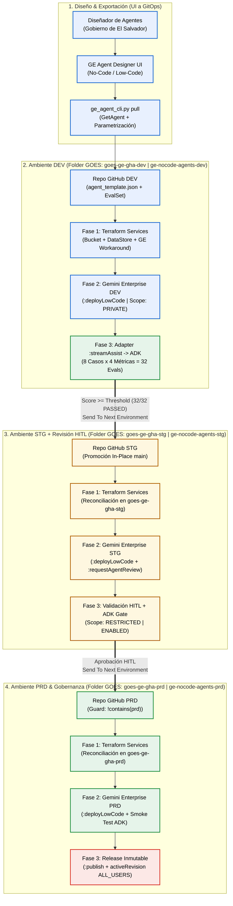

# Documentación Técnica y Operativa: CI/CD In-Place (`dev` $\rightarrow$ `stg` $\rightarrow$ `prd`) y Evaluación Automatizada (`google-adk`) para Agentes No-Code en Gemini Enterprise (GOES)

> [!IMPORTANT]
> **Resumen Ejecutivo**: Esta documentación describe la arquitectura, el modelo de gobierno y la implementación en vivo de **Integración, Evaluación Continua (`google-adk`) y Promoción In-Place Multi-Repositorio (`dev` $\rightarrow$ `stg` $\rightarrow$ `prd`)** para agentes **No-Code / Low-Code** creados en **Gemini Enterprise (Agent Designer)** para el **Gobierno de El Salvador (GOES)**. Incluye dos implementaciones completas desplegadas y certificadas en vivo dentro de la carpeta de Google Cloud **`GOES` (`folders/402619928367`)**:
> 1. **Opción A — GitHub Actions**: 3 repositorios (`ge-nocode-agents-{dev,stg,prd}`) desplegados contra 3 proyectos GCP (`goes-ge-gha-{dev,stg,prd}`).
> 2. **Opción B — Google Cloud Build**: 3 repositorios (`ge-nocode-agents-cb-{dev,stg,prd}`) desplegados y promovidos con Cloud Build contra 3 proyectos GCP (`goes-ge-cb-{dev,stg,prd}`).

---

## 1. Diagramas de Arquitectura Corporativa (`GitHub Actions` y `Google Cloud Build`)

Ambos flujos siguen el patrón **In-Place Multi-Repositorio (`Send To Next Environment`)**, donde los 3 repositorios (`dev`, `stg`, `prd`) mantienen **exactamente el mismo código fuente** sin IDs quemados (*hardcoded*). En tiempo de ejecución, el pipeline genera *in-place* el archivo `spec_variables.auto.yaml`, hidrata la plantilla del agente ([`agent_template.json`](file:///usr/local/google/home/danielardzmtz/Desktop/github_repos/ge-nocode-cicd/ge-nocode-agents-dev/agents/sv_citizen_assistant/agent_template.json)), compila el grafo No-Code en Gemini Enterprise (`:deployLowCode`), ejecuta la compuerta de calidad con **`google-adk`** ([`run_eval.py`](file:///usr/local/google/home/danielardzmtz/Desktop/github_repos/ge-nocode-cicd/ge-nocode-agents-dev/eval/run_eval.py)) y promueve el código al siguiente ambiente.

### Opción A: Arquitectura CI/CD In-Place con GitHub Actions (`goes-ge-gha-{dev,stg,prd}`)



### Opción B: Arquitectura CI/CD In-Place con Google Cloud Build (`goes-ge-cb-{dev,stg,prd}`)

```mermaid
flowchart TD
    subgraph SG_Design["1. Diseño & Exportación (UI a GitOps)"]
        direction LR
        Designer["Diseñador de Agentes<br/>(Gobierno de El Salvador)"]:::gcpBlue
        GE_UI["GE Agent Designer UI<br/>(No-Code / Low-Code)"]:::gcpBlue
        Pull_CLI["ge_agent_cli.py pull<br/>(GetAgent + Parametrización)"]:::gcpBlue
        Designer --> GE_UI --> Pull_CLI
    end

    Pull_CLI --> Repo_Dev

    subgraph SG_Dev["2. Proyecto GCP DEV (Folder GOES: goes-ge-cb-dev | ge-nocode-agents-cb-dev)"]
        direction LR
        Repo_Dev["Repo GitHub DEV<br/>(ge-nocode-agents-cb-dev)"]:::gcpBlue
        CB_Deploy_Dev["Cloud Build: Terraform + Deploy<br/>(cloudbuild_deploy_and_eval.yaml)"]:::gcpBlue
        GE_Dev["Gemini Enterprise DEV<br/>(:deployLowCode + :streamAssist ADK Gate)"]:::gcpGreen
        SM_Dev["Secret Manager<br/>(github-token-user + ge-adc-credentials)"]:::gcpBlue
        CB_Promo_Dev["Cloud Build Promote<br/>(cloudbuild_deployment_actions.yaml)"]:::gcpBlue
        Repo_Dev --> CB_Deploy_Dev --> GE_Dev --> CB_Promo_Dev
        SM_Dev -.->|"Inyecta secretEnv"| CB_Promo_Dev
    end

    CB_Promo_Dev ==>|"git push target-repo main --force<br/>(Promoción DEV -> STG)"| Repo_Stg

    subgraph SG_Stg["3. Proyecto GCP STG + Aprobación HITL (Folder GOES: goes-ge-cb-stg | ge-nocode-agents-cb-stg)"]
        direction LR
        Repo_Stg["Repo GitHub STG<br/>(ge-nocode-agents-cb-stg)"]:::gcpYellow
        CB_Deploy_Stg["Cloud Build: Terraform + Deploy<br/>(cloudbuild_deploy_and_eval.yaml)"]:::gcpYellow
        GE_Stg["Gemini Enterprise STG<br/>(:deployLowCode + ADK + :requestAgentReview)"]:::gcpYellow
        HITL_Stg["Aprobación HITL<br/>(Cloud Build Approval Gate + RESTRICTED)"]:::gcpYellow
        CB_Promo_Stg["Cloud Build Promote<br/>(cloudbuild_deployment_actions.yaml)"]:::gcpYellow
        Repo_Stg --> CB_Deploy_Stg --> GE_Stg --> HITL_Stg --> CB_Promo_Stg
    end

    CB_Promo_Stg ==>|"git push target-repo main --force<br/>(Promoción STG -> PRD)"| Repo_Prd

    subgraph SG_Prd["4. Proyecto GCP PRD & Gobernanza (Folder GOES: goes-ge-cb-prd | ge-nocode-agents-cb-prd)"]
        direction LR
        Repo_Prd["Repo GitHub PRD<br/>(ge-nocode-agents-cb-prd)"]:::gcpGreen
        CB_Deploy_Prd["Cloud Build: Terraform + Deploy<br/>(cloudbuild_deploy_and_eval.yaml)"]:::gcpGreen
        GE_Prd["Gemini Enterprise PRD<br/>(:deployLowCode + Smoke Test ADK)"]:::gcpGreen
        Pub_Prd["Release Inmutable Ciudadano<br/>(:publish + activeRevision ALL_USERS)"]:::gcpRed
        Logs_Prd["Cloud Logging<br/>(CLOUD_LOGGING_ONLY + Auditoría ADK)"]:::gcpBlue
        Repo_Prd --> CB_Deploy_Prd --> GE_Prd --> Pub_Prd
        CB_Deploy_Prd -.->|"Trazabilidad"| Logs_Prd
    end

    classDef gcpBlue fill:#E8F0FE,stroke:#1967D2,stroke-width:2px,color:#000;
    classDef gcpGreen fill:#E6F4EA,stroke:#1E8E3E,stroke-width:2px,color:#000;
    classDef gcpYellow fill:#FEF7E0,stroke:#B06000,stroke-width:2px,color:#000;
    classDef gcpRed fill:#FCE8E6,stroke:#D93025,stroke-width:2px,color:#000;
```



---

## 2. Inventario de Recursos Desplegados en Vivo (`folders/402619928367` — `GOES`)

Todos los recursos fueron aprovisionados dentro de la carpeta **`GOES` (`folders/402619928367`)** en la organización `danielardzmtz.altostrat.com` (`298580255441`). Cada uno de los 6 proyectos cuenta con:
- **Licenciamiento Gemini Enterprise**: `LicenseConfig` (`free_trial_gemini`), `UserStore` (`default_user_store` con `enableLicenseAutoRegister: true`) y `UserLicense` asignada a `admin@danielardzmtz.altostrat.com`.
- **Vertex AI Search Data Store (RAG)**: `sv-tramites-datastore` con el documento normativo indexado `manual-oficial-tramites-goes-2026` (*RNPN, DGME, Centros Penales, SERTRACEN y VMT*).
- **Gemini Enterprise Engine & Assistant**: `sv-citizen-engine` (`SOLUTION_TYPE_GENERATIVE_CHAT`, `APP_TYPE_INTRANET`) + `assistants/default_assistant`.

### 2.1. Ejemplo 1: Flujo Multi-Repo con **GitHub Actions** (`goes-ge-gha-{dev,stg,prd}`)

| Ambiente | Repositorio GitHub | Proyecto GCP (`folders/402619928367`) | Project Number | Agent ID en GE | Estado / Sharing Scope | Active Revision (`:publish`) | Ejecución Certificada |
| :--- | :--- | :--- | :--- | :--- | :--- | :--- | :--- |
| **`DEV`** | `danielardzmtz01/ge-nocode-agents-dev` | `goes-ge-gha-dev` | `1076809815833` | `2172421677339450929` | `PRIVATE` / `ENABLED` | `5074119707885744899` | `ge_agent_deploy_and_eval.yml` (`32/32 PASSED`) $\rightarrow$ `deployment_actions.yml` (`DEV -> STG`) |
| **`STG`** | `danielardzmtz01/ge-nocode-agents-stg` | `goes-ge-gha-stg` | `345628853626` | `11971858956007198093` | `ENABLED` / `RESTRICTED` (`:requestAgentReview`) | — | Run `#37829481031` (`32/32 PASSED`) $\rightarrow$ Run `#37829865204` (`STG -> PRD`) |
| **`PRD`** | `danielardzmtz01/ge-nocode-agents-prd` | `goes-ge-gha-prd` | `30228259118` | `3395946724750775553` | `ENABLED` / `ALL_USERS` (`:publish`) | **`14012846407794653890`** | Run `#37830002863` (`32/32 PASSED` + Revisión Inmutable) |

### 2.2. Ejemplo 2: Flujo Multi-Repo con **Google Cloud Build** (`goes-ge-cb-{dev,stg,prd}`)

| Ambiente | Repositorio GitHub | Proyecto GCP (`folders/402619928367`) | Project Number | Agent ID en GE | Estado / Sharing Scope | Active Revision (`:publish`) | Build IDs de Cloud Build |
| :--- | :--- | :--- | :--- | :--- | :--- | :--- | :--- |
| **`DEV`** | `danielardzmtz01/ge-nocode-agents-cb-dev` | `goes-ge-cb-dev` | `601937217732` | `14529129893765249992` | `PRIVATE` / `PRIVATE` (`:deployLowCode`) | — | Deploy & Eval: `2cc7b284-2305-40c1-94b7-5d8baf86dcdd`<br>Promote `DEV -> STG`: `d54271cb-20d3-46cd-9c35-095b20b7c65c` |
| **`STG`** | `danielardzmtz01/ge-nocode-agents-cb-stg` | `goes-ge-cb-stg` | `425990910052` | `4987620311259970191` | `ENABLED` / `RESTRICTED` (`:requestAgentReview`) | — | Deploy & Eval: `49333be0-9f9f-4aeb-93a0-a83de0d0667f`<br>Promote `STG -> PRD`: `0799e90e-16ff-4630-965d-6616d87a3e7f` |
| **`PRD`** | `danielardzmtz01/ge-nocode-agents-cb-prd` | `goes-ge-cb-prd` | `1068386666374` | `3632113936026526418` | `ENABLED` / `ALL_USERS` (`:publish`) | **`8793931032536939173`** | Deploy, Eval & Publish: `9d873c5e-e35d-4025-8483-4aa13fea0f91` |

---

## 3. Estructura del Código y Componentes Clave

```text
.
├── .github/workflows/                         # OPCIÓN A: Pipelines de GitHub Actions
│   ├── ge_agent_deploy_and_eval.yml           # Hidrata spec_variables.auto.yaml, despliega con :deployLowCode, evalúa con ADK y publica
│   └── deployment_actions.yml                 # "Send To Next Environment" (clona SOURCE_REPO_FN y hace push a TARGET_REPO_FN)
├── cloudbuild/                                # OPCIÓN B: Pipelines de Google Cloud Build
│   ├── cloudbuild_deploy_and_eval.yaml        # Pipeline equivalente en Cloud Build con Secret Manager y CLOUD_LOGGING_ONLY
│   └── cloudbuild_deployment_actions.yaml     # Promoción In-Place (DEV -> STG -> PRD) desde Cloud Build
├── cli/
│   └── ge_agent_cli.py                        # CLI GitOps: pull, push (:deployLowCode), request-review, publish (/revisions) y rollback
├── eval/
│   ├── ge_adk_adapter.py                      # Invoca :streamAssist en GE y traduce la respuesta a google.adk.evaluation.eval_case.Invocation
│   └── run_eval.py                            # Ejecuta el Golden Dataset concurrentemente con los evaluadores oficiales de google-adk
├── agents/
│   └── sv_citizen_assistant/
│       ├── agent_template.json                # Definición declarativa del Agente No-Code con placeholders (${ENV}, ${GE_PROJECT_ID}, ...)
│       ├── eval_config.json                   # Umbrales y rúbricas oficiales de google-adk
│       ├── golden_dataset.evalset.json        # 8 casos del Golden Dataset del Gobierno de El Salvador (formato ADK EvalSet)
│       └── corpus/
│           └── manual_oficial_tramites_sv.md  # Corpus normativo oficial indexado en sv-tramites-datastore
└── docs/
    ├── GUIA_ARQUITECTURA_Y_OPERACION.md       # Manual técnico detallado en el repositorio
    └── diagrams/                              # Diagramas Mermaid (.mmd) de GitHub Actions y Cloud Build
```

---

## 4. Funcionamiento Interno del Ciclo de Vida del Agente No-Code en Discovery Engine `v1alpha`

### 4.1. Creación Visual y Extracción Parametrizada (`pull`)
1. Un diseñador funcional crea o ajusta el agente en la consola visual **Gemini Enterprise Agent Designer** en el proyecto `DEV`.
2. Ejecuta [`cli/ge_agent_cli.py`](file:///usr/local/google/home/danielardzmtz/Desktop/github_repos/ge-nocode-cicd/ge-nocode-agents-dev/cli/ge_agent_cli.py) con el subcomando `pull`:
   ```bash
   python3 cli/ge_agent_cli.py pull \
     --project-id goes-ge-gha-dev \
     --location global \
     --engine-id sv-citizen-engine \
     --agent-id 2172421677339450929 \
     --data-store-id sv-tramites-datastore \
     --template-path agents/sv_citizen_assistant/agent_template.json
   ```
3. El comando `pull` elimina metadatos de solo lectura (`name`, `state`, `createTime`, `updateTime`) y reemplaza automáticamente el ID/número de proyecto, ubicación, Data Store y alcance por placeholders (`${ENV}`, `${GE_PROJECT_ID}`, `${GE_LOCATION}`, `${GE_DATA_STORE_ID}`, `${GE_SHARING_SCOPE}`).

### 4.2. Hidratación In-Place y Compilación ADK Gestionada (`push` + `:deployLowCode`)
1. En tiempo de ejecución, el pipeline crea `spec_variables.auto.yaml` con los valores del ambiente activo (`dev`, `stg` o `prd`).
2. `ge_agent_cli.py push` hidrata [`agent_template.json`](file:///usr/local/google/home/danielardzmtz/Desktop/github_repos/ge-nocode-cicd/ge-nocode-agents-dev/agents/sv_citizen_assistant/agent_template.json) y resuelve dinámicamente el **`project_number` numérico** vía Cloud Resource Manager API para los `dataStoreSpecs` dentro de `lowCodeAgentDefinition.nodes[*].llmAgentNode.dataStoreSpecs` (requisito estricto del compilador interno de Discovery Engine).
3. Invoca `CreateAgent` (`POST .../agents`) o `UpdateAgent` (`PATCH .../agents/{id}?updateMask=displayName,description,lowCodeAgentDefinition`).
4. Invoca el endpoint de compilación:
   ```http
   POST https://discoveryengine.googleapis.com/v1alpha/{agent_name}:deployLowCode
   {
     "name": "projects/{project_number}/locations/global/collections/default_collection/engines/sv-citizen-engine/assistants/default_assistant/agents/{agent_id}",
     "deployMode": "DEPLOY"
   }
   ```

### 4.3. Adaptador `:streamAssist` $\rightarrow$ `google-adk` y Compuerta de Calidad (`eval/run_eval.py`)
Dado que los agentes No-Code viven dentro del runtime gestionado de Gemini Enterprise y se consumen por `POST /v1alpha/{assistant}:streamAssist`, el adaptador [`eval/ge_adk_adapter.py`](file:///usr/local/google/home/danielardzmtz/Desktop/github_repos/ge-nocode-cicd/ge-nocode-agents-dev/eval/ge_adk_adapter.py) construye objetos nativos `google.adk.evaluation.eval_case.Invocation` compatibles con todos los evaluadores oficiales de `google-adk`:
- **`app_details` (`AppDetails`)**: Registra las instrucciones del sistema (`root_citizen_router`) y la declaración formal de la herramienta `vertex_ai_search` para que los jueces LLM (`HallucinationsV1Evaluator` y `RubricBasedFinalResponseQualityV1Evaluator`) reconozcan las herramientas declaradas del agente No-Code.
- **`intermediate_data` (`InvocationEvents`)**: Empaqueta el `FunctionCall(name="vertex_ai_search", args={"query": ...})` junto con el `FunctionResponse` que contiene los pasajes recuperados del Data Store (`sv-tramites-datastore`), permitiendo que tanto `TrajectoryEvaluator` como `HallucinationsV1Evaluator` inspeccionen la traza completa.

#### Los 8 Casos del Golden Dataset del GOES ([`golden_dataset.evalset.json`](file:///usr/local/google/home/danielardzmtz/Desktop/github_repos/ge-nocode-cicd/ge-nocode-agents-dev/agents/sv_citizen_assistant/golden_dataset.evalset.json))

| ID del Caso (`eval_id`) | Institución | Escenario Evaluado | Uso Esperado de Herramienta |
| :--- | :--- | :--- | :--- |
| `01_renovacion_dui_costo_y_requisitos` | **RNPN** | Renovación de DUI vencido (`$10.31 USD`, `https://www.dui.sv`, Duicentro) | `vertex_ai_search` |
| `02_emision_dui_primera_vez_gratuidad` | **RNPN** | Emisión de DUI por primera vez al cumplir 18 años (**Trámite gratuito `$0.00 USD`**) | `vertex_ai_search` |
| `03_emision_pasaporte_primera_vez_adulto` | **DGME** | Pasaporte ordinario primera vez adulto (`$25.00 USD` en Centroamérica, vigencia 6 años) | `vertex_ai_search` |
| `04_pasaporte_menor_de_edad_autorizacion_padres` | **DGME** | Pasaporte para menor de edad (autorización de ambos padres, acta notarial o poder consular) | `vertex_ai_search` |
| `05_solvencia_antecedentes_penales_en_linea` | **DGCP** | Solvencia de Antecedentes Penales (`$3.00 USD`, Portal Simple.sv) | `vertex_ai_search` |
| `06_renovacion_licencia_conducir_sertracen` | **SERTRACEN / VMT** | Renovación de licencia de conducir (`$49.43 USD`, exámenes visual/médico, cero esquelas pendientes) | `vertex_ai_search` |
| `07_conversacion_multiturno_extravio_dui_y_pasaporte` | **RNPN + DGME** | Conversación multi-turno (2 turnos con sesión persistente): extravío de DUI y pasaporte en el mismo día (`$10.31 + $25.00 = $35.31 USD`) | `vertex_ai_search` (x2) |
| `08_rechazo_tramite_fuera_de_alcance_exoneracion_multa` | **Guardrail VMT** | Solicitud fuera de alcance (borrar multa del sistema / redactar demanda judicial) $\rightarrow$ Rechazo cortés y orientación al VMT/SERTRACEN | Sin llamada a herramienta (`[]`) |

#### Las 4 Métricas Oficiales de `google-adk` ([`eval_config.json`](file:///usr/local/google/home/danielardzmtz/Desktop/github_repos/ge-nocode-cicd/ge-nocode-agents-dev/agents/sv_citizen_assistant/eval_config.json))

1. **`tool_trajectory_avg_score` (Threshold `1.0`, `EXACT`)**: Valida determinísticamente que el agente consulte `vertex_ai_search` en preguntas de trámites (Casos 01–07) y no ejecute búsquedas innecesarias ante solicitudes fuera de alcance (Caso 08).
2. **`final_response_match_v2` (Threshold `0.80`)**: Juez LLM (`gemini-2.5-flash`) que certifica equivalencia semántica y exactitud de montos/requisitos frente a la respuesta de referencia.
3. **`hallucinations_v1` (Threshold `0.85`)**: Evalúa frase por frase que ningún dato entregado al ciudadano contradiga o exceda el documento oficial del Data Store.
4. **`rubric_based_final_response_quality_v1` (Threshold `0.85`)**: Evalúa 3 rúbricas institucionales obligatorias:
   - `exactitud_aranceles_usd`
   - `estructura_institucional_3_partes`
   - `tono_y_guardrails_institucionales`

### 4.4. Revisión HITL en `STG` (`:requestAgentReview`) y Publicación Inmutable en `PRD` (`:publish`)
- **En `STG` (`request-review`)**: Una vez superada la evaluación ADK en Staging, `ge_agent_cli.py request-review` transiciona el agente de `PRIVATE` a `ENABLED` mediante `:requestAgentReview` y actualiza `sharingConfig.scope = RESTRICTED` para que los revisores funcionales del GOES realicen pruebas de aceptación (UAT / HITL).
- **En `PRD` (`publish`)**: Tras la promoción a Producción y el pase del Smoke Test ADK, `ge_agent_cli.py publish` habilita el agente (`ENABLED`), configura `sharingConfig.scope = ALL_USERS` y ejecuta `:publish`, creando una **`AgentRevision` inmutable** (`revisions/{revision_id}`) vinculada en `activeRevision`.

### 4.5. Rollback Inmediato en Producción (`rollback`)
Si se detecta cualquier anomalía en producción, se puede revertir instantáneamente a una revisión inmutable anterior o re-desplegar un commit previo:
```bash
python3 cli/ge_agent_cli.py rollback \
  --vars-file spec_variables.auto.yaml \
  --agent-id 3395946724750775553 \
  --revision-id 14012846407794653890
```

---

## 5. Matriz de Configuración por Ambiente (GitHub Actions y Google Cloud Build)

### 5.1. Variables por Repositorio / Trigger

| Variable (`vars.*` en GitHub / `_VAR` en Cloud Build) | Ambiente `DEV` | Ambiente `STG` | Ambiente `PRD` |
| :--- | :--- | :--- | :--- |
| `ENV` / `_ENV` | `dev` | `stg` | `prd` |
| `TARGET_ENV` / `_TARGET_ENV` | `stg` | `prd` | *(Bloqueado por guard)* |
| `SOURCE_REPO_FN` / `_SOURCE_REPO_FN` | `danielardzmtz01/ge-nocode-agents{-cb}-dev.git` | `danielardzmtz01/ge-nocode-agents{-cb}-stg.git` | *(N/A)* |
| `SOURCE_REPO_SN` / `_SOURCE_REPO_SN` | `ge-nocode-agents{-cb}-dev` | `ge-nocode-agents{-cb}-stg` | *(N/A)* |
| `TARGET_REPO_FN` / `_TARGET_REPO_FN` | `danielardzmtz01/ge-nocode-agents{-cb}-stg.git` | `danielardzmtz01/ge-nocode-agents{-cb}-prd.git` | *(N/A)* |
| `GE_PROJECT_ID` / `_GE_PROJECT_ID` | `goes-ge-{gha\|cb}-dev` | `goes-ge-{gha\|cb}-stg` | `goes-ge-{gha\|cb}-prd` |
| `GE_LOCATION` / `_GE_LOCATION` | `global` | `global` | `global` |
| `GE_ENGINE_ID` / `_GE_ENGINE_ID` | `sv-citizen-engine` | `sv-citizen-engine` | `sv-citizen-engine` |
| `GE_DATA_STORE_ID` / `_GE_DATA_STORE_ID` | `sv-tramites-datastore` | `sv-tramites-datastore` | `sv-tramites-datastore` |
| `GE_SHARING_SCOPE` / `_GE_SHARING_SCOPE` | `PRIVATE` | `RESTRICTED` | `ALL_USERS` |

### 5.2. Secretos y Permisos IAM Requeridos

- **En GitHub Actions (`secrets.*`)**:
  - `TOKEN_USER`: Token de GitHub con permisos `repo` y `workflow` para ejecutar `Send To Next Environment`.
  - `GOOGLE_CREDENTIALS` (o Workload Identity Federation vía `vars.WIF_PROVIDER` + `vars.WIF_SERVICE_ACCOUNT`): Credencial con acceso a Discovery Engine, Cloud Storage y Vertex AI.
- **En Google Cloud Build (Secret Manager + IAM)**:
  - Secretos en Secret Manager por proyecto (`goes-ge-cb-{dev,stg,prd}`):
    - `github-token-user`: Token de GitHub para que `cloudbuild_deployment_actions.yaml` haga `git push` al repositorio del siguiente ambiente.
    - `ge-adc-credentials`: Credencial con acceso a Discovery Engine (`v1alpha`), Cloud Storage y Vertex AI (`aiplatform.googleapis.com`).
  - Roles IAM asignados a las cuentas de servicio de CI/CD (`ge-cicd-runner`, `{PROJECT_NUMBER}@cloudbuild.gserviceaccount.com` y `{PROJECT_NUMBER}-compute@developer.gserviceaccount.com`):
    - `roles/discoveryengine.admin`
    - `roles/aiplatform.user`
    - `roles/secretmanager.secretAccessor`
    - `roles/storage.admin`
    - `roles/serviceusage.serviceUsageAdmin`
    - `roles/logging.logWriter`

---

## 6. Integración con IaC Corporativo (Terraform + Workaround `v1alpha`)

Siguiendo el estándar corporativo de repositorios de infraestructura (`terraform_projects/` + `terraform_services/`), cada repositorio de ambiente (`dev`, `stg`, `prd`) incluye el código declarativo de Terraform y lo conecta directamente con el despliegue del agente No-Code:

| División | Directorio / Componente | Qué es Nativo en Terraform vs. Workaround `v1alpha` | Cómo se conecta con el Agente No-Code |
| :--- | :--- | :--- | :--- |
| **1. Landing Zone Corporativa** | `terraform_projects/` (`folders.tf`, `projects.tf`, `variables.tf`) | **100% Nativo en Terraform**: `google_folder` (`GOES`), `google_project` (los 6 proyectos), `google_project_service` (APIs), `google_service_account` (`ge-cicd-runner`), `google_project_iam_member` y `google_secret_manager_secret`. | Prepara el entorno seguro por ambiente (`dev`, `stg`, `prd`) donde correrán los pipelines. |
| **2. Repositorios y Variables** | 6 Repositorios en GitHub (`ge-nocode-agents-{dev,stg,prd}` y `ge-nocode-agents-cb-{dev,stg,prd}`) | **Configuración GitOps por Ambiente**: Variables (`ENV`, `GE_PROJECT_ID`, `GE_ENGINE_ID`, `GE_DATA_STORE_ID`, `GE_SHARING_SCOPE`, `TARGET_ENV`, `TARGET_REPO_FN`) y Secretos (`GOOGLE_CREDENTIALS`, `TOKEN_USER`). | Inyecta en tiempo de ejecución las variables en `spec_variables.auto.tfvars` (para Terraform) y `spec_variables.auto.yaml` (para el CLI del Agente). |
| **3. Servicios Gemini Enterprise** | `terraform_services/` (`main.tf`, `outputs.tf`) + `cli/ensure_ge_infra.py` | **Híbrido (Nativo + Workaround Declarativo)**:<br>• **Nativo**: `google_storage_bucket` (bucket del corpus), `google_storage_bucket_object` (`manual_oficial_tramites_sv.md`) y `google_discovery_engine_data_store` (`sv-tramites-datastore`).<br>• **Workaround (`terraform_data.gemini_enterprise_engine_and_corpus`)**: Ejecuta `local-exec` (`python3 cli/ensure_ge_infra.py`) con trigger `filemd5(corpus)` para reconciliar idempotentemente en la API `v1alpha`: `LicenseConfig`, `UserStore`, el documento RAG indexado, el `Engine` (`APP_TYPE_INTRANET` + `SEARCH_ADD_ON_LLM`) y el `default_assistant`. | Al finalizar `terraform apply`, el pipeline lee `terraform output -raw ge_data_store_id` y `terraform output -raw ge_engine_id` y escribe `spec_variables.auto.yaml`, alimentando automáticamente el despliegue del Agente No-Code. |
| **4. Ciclo de Vida del Agente No-Code y Evaluación ADK** | `cli/ge_agent_cli.py` + `eval/run_eval.py` | **CLI Declarativo REST `v1alpha` + `google-adk`**: Hidrata `agent_template.json` con los outputs de Terraform, compila el grafo No-Code (`:deployLowCode`), evalúa las 32 métricas con `google-adk` y gobierna el estado (`:requestAgentReview` en STG / `:publish` en PRD). | Garantiza que ningún cambio en la infraestructura RAG ni en el prompt No-Code llegue a producción sin superar el Quality Gate. |

---

## 7. Detalle Paso a Paso del Ciclo de Vida del Agente No-Code (`cli/ge_agent_cli.py`)

El script `cli/ge_agent_cli.py` encapsula las 6 operaciones del ciclo de vida de un agente No-Code / Low-Code sobre la API `v1alpha` de Discovery Engine (`https://discoveryengine.googleapis.com/v1alpha`):

1. **`pull` — Exportación desde Agent Designer UI y Parametrización (`DEV` -> Git)**:
   - Cuando un diseñador o analista modifica las instrucciones, los *starter prompts* o las herramientas en la consola visual de **Agent Designer (`DEV`)**, ejecuta `python3 cli/ge_agent_cli.py pull`.
   - El CLI invoca `GET /v1alpha/projects/{project}/locations/global/collections/default_collection/engines/{engine}/assistants/default_assistant/agents/{agent_id}`.
   - Limpia los metadatos efímeros de solo lectura (`createTime`, `updateTime`, `state`, `activeRevision`) y **reemplaza automáticamente todos los IDs de `DEV`** (ID del proyecto, número de proyecto, Engine ID, Data Store ID y sufijo `(DEV)`) por los placeholders `${GE_PROJECT_ID}`, `${GE_ENGINE_ID}`, `${GE_DATA_STORE_ID}` y `${ENV_UPPER}`, guardando el archivo `agents/sv_citizen_assistant/agent_template.json` listo para hacer `git commit`.
2. **`push` — Hidratación In-Place y Compilación `:deployLowCode` (Git -> `DEV` / `STG` / `PRD`)**:
   - Lee `spec_variables.auto.yaml` (generado a partir de los outputs de Terraform del ambiente actual) y sustituye los placeholders en `agent_template.json`.
   - Resuelve dinámicamente el `project_number` numérico del proyecto destino (requerido internamente por el parser de Vertex AI Search en `lowCodeAgentDefinition.nodes[].llmAgentNode.selectedTools.dataStoreSpecs`).
   - Busca por `displayName` si el agente ya existe en el `default_assistant` del ambiente: si no existe ejecuta `POST .../agents` (creación); si ya existe ejecuta `PATCH .../agents/{id}?updateMask=displayName,description,lowCodeAgentDefinition` (actualización idempotente).
   - Finalmente invoca **`POST /v1alpha/{agent_name}:deployLowCode`** con `{"name": agent_name, "deployMode": "DEPLOY"}`, que compila los nodos `lowCodeAgentDefinition` y activa el agente en el motor conversacional.
3. **`request-review` — Solicitud de Revisión Humana HITL (`STG`)**:
   - Tras aprobar las 32 métricas de `google-adk` en `STG`, el pipeline invoca `python3 cli/ge_agent_cli.py request-review`.
   - Ejecuta **`POST /v1alpha/{agent_name}:requestAgentReview`** (transicionando el agente fuera de `PRIVATE`) y aplica `PATCH ?updateMask=sharingConfig` con `{"sharingConfig": {"scope": "RESTRICTED"}}`, habilitando el agente únicamente para el equipo revisor de QA/Gobernanza antes de autorizar el pase a `PRD`.
4. **`publish` — Revisión Inmutable y Publicación General (`PRD`)**:
   - Tras aprobar el Smoke Test de `google-adk` en `PRD`, el pipeline invoca `python3 cli/ge_agent_cli.py publish`.
   - Asegura que el agente esté en estado `ENABLED`, actualiza su alcance a `sharingConfig.scope = "ALL_USERS"`, e invoca **`POST /v1alpha/{agent_name}:publish`** con la etiqueta del commit (`label: "Automated PRD release from commit ..."`).
   - Esto genera un snapshot inmutable (`AgentRevision`) y actualiza el puntero `activeRevision` del agente productivo.
5. **`rollback` — Reversión Instantánea en Producción (`PRD`)**:
   - Ejecuta **`POST /v1alpha/{agent_name}:rollback`** apuntando a un `revisionId` previo para revertir el agente en segundos sin necesidad de recompilar.
6. **`delete` — Limpieza del Agente Custom para Reinicio de Demos (`STG` / `PRD`)**:
   - Ejecuta `POST :disableAgent` seguido de **`DELETE /v1alpha/{agent_name}`** para dejar los ambientes de `STG` y `PRD` limpios antes de una demostración manual en vivo.

---

## 8. Guía Paso a Paso para Prueba Manual en Vivo (`DEV` -> `STG` -> `PRD`)

Para realizar la demostración práctica de principio a fin (con **`DEV` ya desplegado** y **`STG` / `PRD` limpios**):

1. **Paso 0 (Si tu sesión local de `gcloud` expiró tras 16 horas)**:
   - Ejecuta en tu terminal:
     ```bash
     gcloud auth application-default login
     python3 cli/refresh_credentials_and_reset_demo.py
     ```
   - Este script actualiza automáticamente el secreto `GOOGLE_CREDENTIALS` en los 6 repositorios de GitHub y en Secret Manager (`goes-ge-cb-*`), elimina el agente custom de `STG` y `PRD` (dejando únicamente `DEV` activo) y limpia el historial de ejecuciones de `STG` y `PRD`.
2. **Paso 1 — Verificar o Editar el Agente en `DEV` (`goes-ge-gha-dev`)**:
   - Entra a la consola de **Gemini Enterprise -> Agent Designer** en el proyecto `goes-ge-gha-dev` (`sv-citizen-engine`).
   - Verás el agente **`Asistente de Trámites Ciudadanos - Gobierno de El Salvador (DEV)`** (`ID: 2172421677339450929`).
   - En los proyectos `goes-ge-gha-stg` y `goes-ge-gha-prd` comprobarás que el agente custom **no existe** todavía.
3. **Paso 2 — Promover manualmente de `DEV` a `STG`**:
   - Ve al repositorio **`danielardzmtz01/ge-nocode-agents-dev`** -> pestaña **Actions** -> selecciona **`Send To Next Environment`** -> haz clic en **`Run workflow`** (branch `main`).
   - Abre la pestaña **Actions** del repositorio **`danielardzmtz01/ge-nocode-agents-stg`**: verás iniciarse automáticamente el workflow **`GE No-Code Agent Deploy & ADK Eval Actions`**, ejecutando:
     - **Fase 1 (IaC)**: `terraform init`, `terraform plan`, `terraform apply` en `goes-ge-gha-stg` (reconciliando bucket GCS, Data Store `sv-tramites-datastore` y el workaround `ensure_ge_infra.py`).
     - **Fase 2 (No-Code CD)**: `ge_agent_cli.py push` creando y compilando (`:deployLowCode`) el agente en `goes-ge-gha-stg`.
     - **Fase 3 (ADK Gate + HITL)**: `eval/run_eval.py` validando las 32 métricas (`PASSED`) y ejecutando `:requestAgentReview` (`RESTRICTED`).
4. **Paso 3 — Promover manualmente de `STG` a `PRD`**:
   - Tras verificar el agente en `STG`, ve al repositorio **`danielardzmtz01/ge-nocode-agents-stg`** -> pestaña **Actions** -> selecciona **`Send To Next Environment`** -> haz clic en **`Run workflow`**.
   - Abre la pestaña **Actions** del repositorio **`danielardzmtz01/ge-nocode-agents-prd`**: verás ejecutarse **`GE No-Code Agent Deploy & ADK Eval Actions`**, que correrá Terraform en `goes-ge-gha-prd`, desplegará el agente No-Code, validará las 32 métricas con `google-adk` y ejecutará **`:publish`** creando la `AgentRevision` inmutable con alcance `ALL_USERS`.

